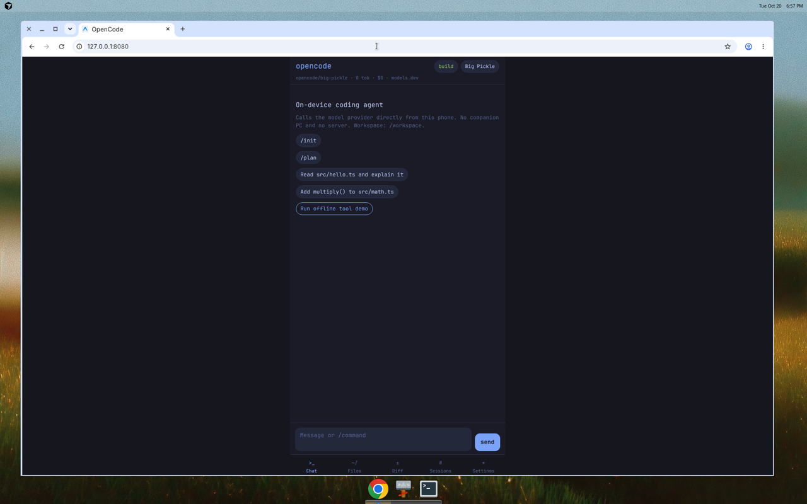
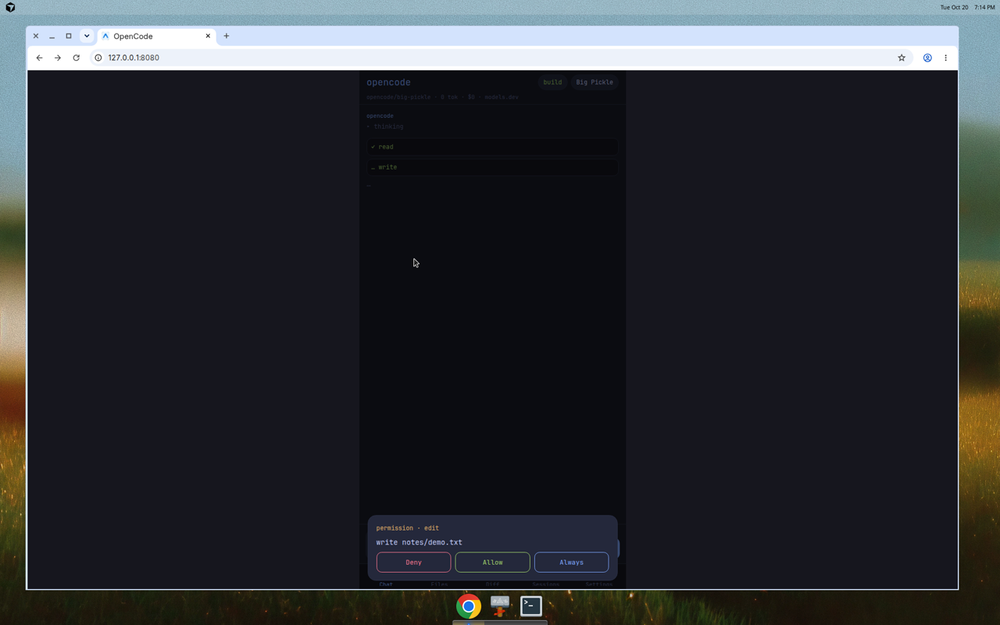
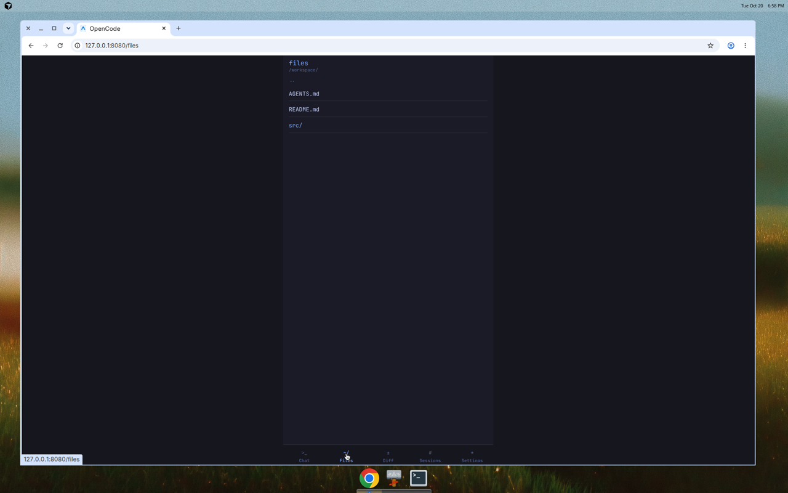
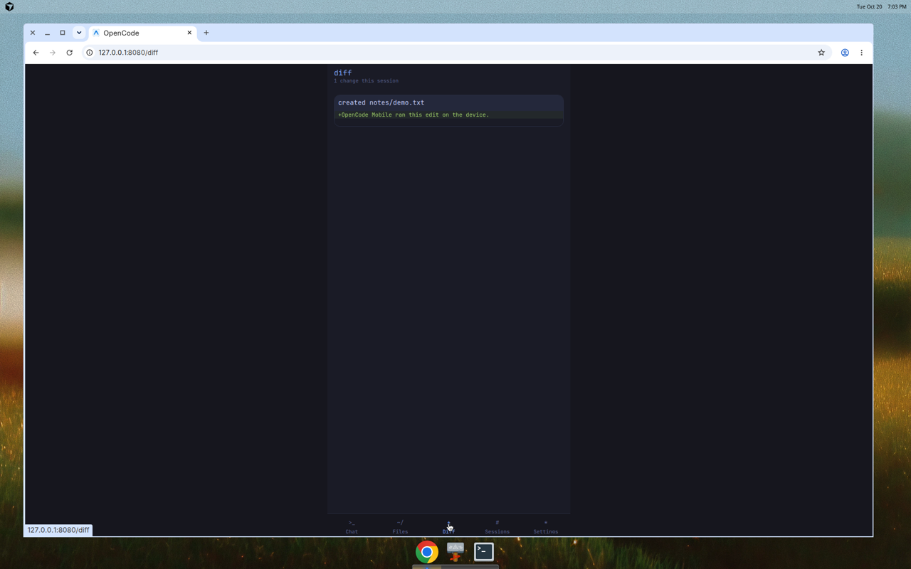
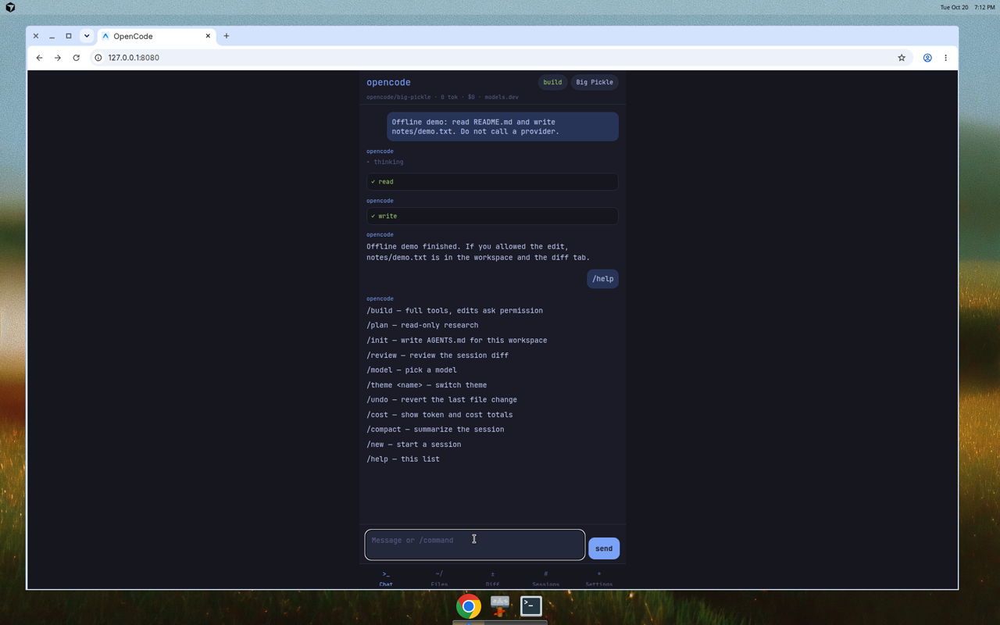
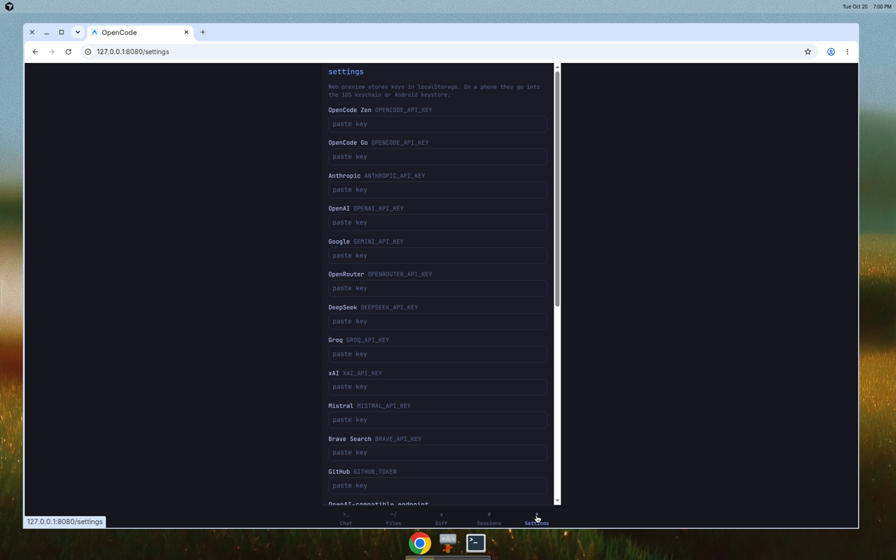

# OpenCode Mobile

On-device coding agent for iPhone and Android. It follows [OpenCode](https://github.com/anomalyco/opencode) (MIT): the same models.dev catalog, the same system prompts and tool semantics, build and plan modes, sessions, slash commands, `AGENTS.md`, and themes. The phone calls the model provider itself. There is no companion PC and no server you have to run.





## What you can do

- Chat with streaming, reasoning, and a running token and cost total.
- Pick a model from the bundled models.dev snapshot, then refresh the live catalog.
- Use OpenCode Zen (including free models such as `opencode/big-pickle`), Anthropic, OpenAI, Google, OpenRouter, DeepSeek, Groq, xAI, Mistral, or any OpenAI-compatible endpoint.
- Read, write, edit, and patch files in an in-app workspace. List, glob, and grep that workspace.
- Keep a session todo list. Fetch a page. Search the web from the device.
- Clone, commit, pull, and push with isomorphic-git and a GitHub token.
- Review diffs and confirm edits before they land.
- Switch build / plan, themes, and sessions. `/init` writes `AGENTS.md`. `/review` reviews the session diff.





## Install on iPhone

You need Node 22 and the [Expo](https://docs.expo.dev/) CLI. The app is Expo SDK 58 / React Native.

### Expo Go

1. Install [Expo Go](https://expo.dev/go) from the App Store. It must support SDK 58. If the store build is older, use the EAS path below.
2. On a computer, clone this repo and install dependencies:

```bash
npm install
npx expo start
```

3. Scan the QR code with the iPhone camera. Expo Go opens the project. The phone and the computer only share the JavaScript bundle. After the app is open, model calls leave the phone and go to the provider. They do not go through your computer.

### Dev build, internal install, TestFlight

When Expo Go cannot load the SDK, build a native binary with EAS. The app never starts a backend of its own.

```bash
npm install -g eas-cli
eas login
eas build --platform ios --profile development
```

- `development` is a dev client (`expo-dev-client` is not required to use the JS you already have; this profile sets `developmentClient` so you can load updates from `npx expo start`).
- `preview` builds an internal distribution binary you can install with the link EAS prints. Android `preview` is an APK.
- `production` is the store build. `eas.json` sets `ITSAppUsesNonExemptEncryption` to false in `app.json`, which is what App Store Connect asks about export compliance.

TestFlight:

```bash
eas build --platform ios --profile production
eas submit --platform ios --profile production
```

Then add testers in App Store Connect. The bundle id is `com.opencode.mobile`.

## Install the Android APK

The release APK is a standalone app. The JavaScript bundle and Hermes bytecode are inside the file. After you install it, the phone does not need a computer, Metro, or a dev server. Model calls still go from the phone to OpenCode Zen or another provider API, so the phone needs a network connection and an API key. There is no on-device LLM in this build.

1. Download [opencode-mobile-v0.1.0.apk](https://github.com/iboshka24/opencode-mobile/releases/download/v0.1.0/opencode-mobile-v0.1.0.apk) from the [v0.1.0 release](https://github.com/iboshka24/opencode-mobile/releases/tag/v0.1.0). The APK is arm64-v8a.
2. On the phone, open the file. If Android asks, allow install from that source.
3. Open **OpenCode**, then **Settings**, and paste an API key. OpenCode Zen free models use `OPENCODE_API_KEY`.
4. Pick a model and send a message. The request leaves the phone and goes to that provider.

To build the same APK yourself you need JDK 17, the Android SDK (platform 37, build-tools 37, NDK 27.1), and Node 22:

```bash
npm ci
npm run apk
```

The script runs `expo prebuild -p android` and `gradlew assembleRelease`. It signs with the sideload keystore in `keystore/` (password `opencode-mobile`, alias `opencode`). That key is for direct install only. It is not a Play App Signing key. The APK is written to `dist/opencode-mobile-v0.1.0.apk`.

Expo Go (`npx expo start`) still works for development. `eas build --platform android --profile preview` is the other way to get an APK.

## Provider setup

Open **Settings** and paste a key. On iOS the key is one Keychain item per provider (`oc.k.<id>`), because a single item cannot hold every key. On Android it uses the keystore. The web preview uses `localStorage` and says so on the settings screen.

| Provider | Settings id | Env name OpenCode uses |
| --- | --- | --- |
| OpenCode Zen | `opencode` | `OPENCODE_API_KEY` |
| OpenCode Go | `opencode-go` | `OPENCODE_API_KEY` (copied from Zen if empty) |
| Anthropic | `anthropic` | `ANTHROPIC_API_KEY` |
| OpenAI | `openai` | `OPENAI_API_KEY` |
| Google | `google` | `GEMINI_API_KEY` |
| OpenRouter | `openrouter` | `OPENROUTER_API_KEY` |
| DeepSeek | `deepseek` | `DEEPSEEK_API_KEY` |
| Groq | `groq` | `GROQ_API_KEY` |
| xAI | `xai` | `XAI_API_KEY` |
| Mistral | `mistral` | `MISTRAL_API_KEY` |

A custom endpoint needs a base URL, a model id, and a protocol (`openai`, `anthropic`, or `google`). Its key is stored under the provider id, default `custom`.

OpenCode Zen free models have input and output cost of 0 in the catalog. The default session model is `opencode/big-pickle`. Chat uses the provider protocol OpenCode derives from the models.dev `npm` package: Anthropic Messages, Gemini `streamGenerateContent`, or OpenAI chat completions. Streaming, tool calls, and reasoning deltas are shown in the transcript.

Web search uses DuckDuckGo from the device. A Brave key (`brave` / `BRAVE_API_KEY`) is optional. GitHub clone and push use the `github` token over HTTPS.





## Tools and modes

| Tool | Behavior |
| --- | --- |
| `read` | Numbered lines, directories, offset and limit |
| `glob`, `grep` | In-workspace search, OpenCode's text format |
| `write`, `edit`, `patch` | Exact edit match, then the OpenCode line-trim fallback. Patch uses the `*** Begin Patch` envelope. Each mutation asks Allow / Deny / Always |
| `todowrite` | Session plan |
| `webfetch`, `websearch` | Direct HTTPS from the device |
| `shell` | JavaScript sandbox only. See limitations |
| `git` | isomorphic-git: init, status, diff, log, commit, clone, pull, push |
| `question` | One question, answered in the app |

**Build** advertises every tool. **Plan** hides `write`, `edit`, and `patch`, and refuses mutating shell and git before the permission prompt. `AGENTS.md` files from the workspace root downward are loaded into the system prompt (24k cap).

Slash commands: `/help` `/plan` `/build` `/init` `/review` `/model` `/models` `/theme` `/themes` `/undo` `/cost` `/compact` `/new` `/clear`. An unknown command is not sent to the model.

Themes: Tokyo Night, Catppuccin, Catppuccin Macchiato, Nord, Gruvbox, One Dark, Everforest, Kanagawa, Matrix, Dracula.

The first empty workspace is seeded with `README.md`, `AGENTS.md`, `src/hello.ts`, and `src/math.ts`. On a phone those files live in the app documents directory. The web preview keeps them in `localStorage`.

**Run offline tool demo** walks the real agent loop with a scripted model: it reads `README.md`, asks permission, and writes `notes/demo.txt`. No API key is required.

## Develop

```bash
npm test          # vitest, agent loop and tools
npm run typecheck # tsc --noEmit
npm run export:web
npm run export:ios
```

Core logic is plain TypeScript in `src/core` and does not import React Native. The Expo UI is `src/app`, `src/runtime`, and `src/ui`.

## Limitations

- The shell is not bash. `pwd`, `ls`, `cat`, `echo`, `mkdir`, `touch`, `rm`, `cp`, `mv`, `head`, `tail`, `wc`, `find`, and `grep` run in a JavaScript sandbox. Pipes, redirects, and anything else (`npm`, `node`, `python`, compilers) return an error. The app does not pretend they succeeded.
- iOS cannot spawn a process. That is why git is isomorphic-git and why tests and builds cannot run on the phone.
- Web search is best-effort HTML and instant answers. It is not a hosted search API.
- The web preview stores files and keys in `localStorage`. GitHub from the browser can fail on CORS. The phone is not subject to that CORS check.
- Models that only speak the OpenAI Responses API will fail on the chat-completions client.
- The catalog snapshot can lag models.dev until you refresh it. A live refresh needs network.
- There is no OpenCode desktop server, no `opencode serve`, and no account sync.

## Attribution

Prompts and tool semantics are from OpenCode, MIT, copyright (c) 2025 opencode. See [NOTICE](NOTICE).

---

## По-русски

OpenCode Mobile — агент для кода, который работает на самом телефоне (iOS и Android). По поведению он близок к [OpenCode](https://github.com/anomalyco/opencode) (лицензия MIT): тот же каталог models.dev, те же системные промпты и семантика инструментов, режимы build и plan, сессии, слэш-команды, `AGENTS.md` и темы. Приложение само ходит в API провайдера. Отдельный компьютер и свой сервер не нужны.

### Установка на iPhone

1. Поставьте [Expo Go](https://expo.dev/go), если он поддерживает Expo SDK 58.
2. На компьютере: `npm install`, затем `npx expo start`, и отсканируйте QR-код камерой iPhone. Компьютер только отдаёт JavaScript-бандл. Запросы к модели уходят с телефона напрямую провайдеру.
3. Если Expo Go не подходит, соберите приложение через EAS:

```bash
npm install -g eas-cli
eas login
eas build --platform ios --profile preview
```

Профиль `development` — dev client. `preview` — внутренняя установка по ссылке EAS. Для TestFlight:

```bash
eas build --platform ios --profile production
eas submit --platform ios --profile production
```

Идентификатор приложения: `com.opencode.mobile`. В `app.json` уже указано `ITSAppUsesNonExemptEncryption: false`.

### Установка APK на Android

Готовый APK — самостоятельное приложение: внутри JavaScript-бандл и Hermes. После установки компьютер, Metro и dev-сервер не нужны. Модель по-прежнему вызывается с телефона через API OpenCode Zen или другого провайдера из models.dev. Своей нейросети на устройстве в этой сборке нет.

1. Скачайте [opencode-mobile-v0.1.0.apk](https://github.com/iboshka24/opencode-mobile/releases/download/v0.1.0/opencode-mobile-v0.1.0.apk) из [релиза v0.1.0](https://github.com/iboshka24/opencode-mobile/releases/tag/v0.1.0). Архитектура — arm64-v8a.
2. Откройте файл на телефоне и разрешите установку из этого источника.
3. В приложении откройте **Settings** и вставьте API-ключ. Для бесплатных моделей OpenCode Zen это `OPENCODE_API_KEY`.
4. Выберите модель и отправьте сообщение. Запрос уходит с телефона напрямую провайдеру.

Собрать тот же APK: JDK 17, Android SDK (platform 37, build-tools 37, NDK 27.1), Node 22, затем `npm ci` и `npm run apk`. Подпись — keystore в `keystore/` (пароль `opencode-mobile`, alias `opencode`), только для прямой установки. Файл появится в `dist/opencode-mobile-v0.1.0.apk`.

Для разработки по-прежнему можно `npx expo start` в Expo Go или `eas build --platform android --profile preview`.

### Ключи и модели

В **Settings** вставьте ключ. На iPhone каждый провайдер — отдельная запись Keychain. На Android — keystore. В веб-превью ключи лежат в `localStorage`, экран настроек об этом пишет прямо.

Поддерживаются OpenCode Zen и его бесплатные модели (по умолчанию `opencode/big-pickle`), OpenCode Go, Anthropic, OpenAI, Google, OpenRouter, DeepSeek, Groq, xAI, Mistral и любой совместимый с OpenAI endpoint (свой base URL и протокол `openai` / `anthropic` / `google`). Каталог грузится из снимка models.dev и обновляется с `https://models.dev/api.json`. В чате есть стриминг, вызов инструментов, блок рассуждений и счётчик токенов и стоимости.

Для git нужен GitHub-токен. Поиск в вебе идёт с устройства через DuckDuckGo; ключ Brave необязателен.

### Что перенесено из OpenCode

Дословно, с указанием авторства в [NOTICE](NOTICE): системные промпты (`system`, GPT, GPT Astra, Anthropic, Kimi, Meta, Trinity), описания инструментов, формат патча `*** Begin Patch`, сопоставление строк в `edit`, промпты `/init` и `/review`, выбор промпта по провайдеру. Сверху добавляется мобильное дополнение: на телефоне нет bash. Файлы промптов OpenCode не переписываются.

Инструменты: `read`, `glob`, `grep`, `write`, `edit`, `patch`, `todowrite`, `webfetch`, `websearch`, `shell`, `git`, `question`. Правки спрашивают разрешение (Allow / Deny / Always). В режиме plan запись файлов скрыта и запрещена.

Команды: `/help` `/plan` `/build` `/init` `/review` `/model` `/models` `/theme` `/themes` `/undo` `/cost` `/compact` `/new` `/clear`.

Кнопка **Run offline tool demo** прогоняет настоящий цикл агента без ключа: чтение `README.md`, запрос разрешения, запись `notes/demo.txt`.

### Проверка

```bash
npm test
npm run typecheck
npm run export:web
npm run export:ios
```

### Ограничения

- `shell` — это не bash, а песочница на JavaScript: `pwd`, `ls`, `cat`, `echo`, `mkdir`, `touch`, `rm`, `cp`, `mv`, `head`, `tail`, `wc`, `find`, `grep`. Пайпы, `npm`, `node`, компиляторы возвращают ошибку. Приложение не делает вид, что команда выполнилась.
- На iOS нельзя запустить процесс, поэтому git — это isomorphic-git, а тесты и сборку на телефоне запустить нельзя.
- Веб-поиск — разбор HTML, без своего бэкенда.
- В браузере файлы и ключи в `localStorage`, а git к GitHub может упереться в CORS. На телефоне CORS нет.
- Модели только с OpenAI Responses API через chat completions не заработают.
- Своего сервера, `opencode serve` и синхронизации аккаунта нет.
